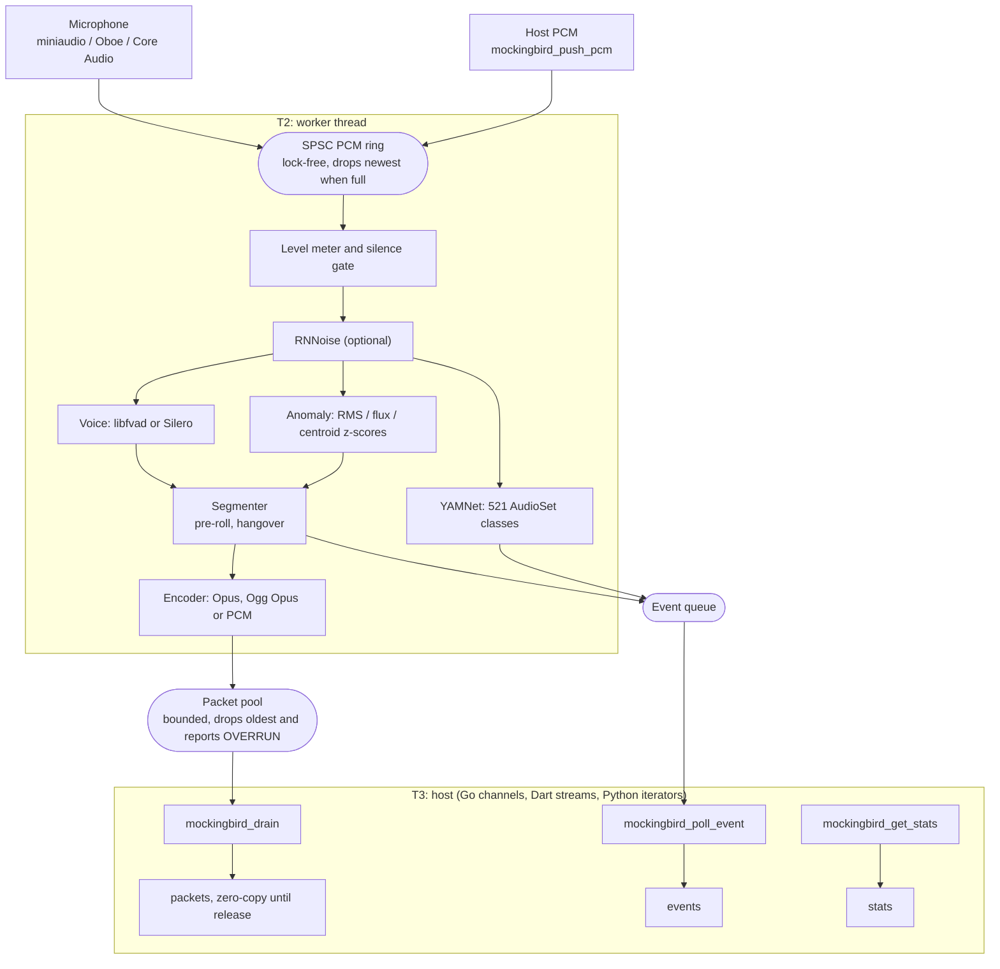

# Mockingbird

Mockingbird is a native audio engine with a plain C ABI. It captures microphone
audio, optionally denoises it, detects human voice in any language and
non-speech acoustic events, classifies what it hears, and streams only the
relevant audio out as encoded packets. The same engine is used from
Dart/Flutter, Go and Python through the bindings in this repository, and from
any other language that can call C.

The pipeline runs live on Android, iOS, macOS, Linux, Windows and, as
WebAssembly, in the browser. The core is fuzzed, stress-tested and fault-injected, and it runs clean
under AddressSanitizer, UndefinedBehaviorSanitizer and ThreadSanitizer.

- Source: https://github.com/Crdzbird/MockingBird
- Flutter package: https://pub.dev/packages/mockingbird
- Issues: https://github.com/Crdzbird/MockingBird/issues

## Contents

- [What it does](#what-it-does)
- [Quick start](#quick-start)
- [Building the core](#building-the-core)
- [Models](#models)
- [Building for the web](#building-for-the-web)
- [Running the Flutter demo on a device](#running-the-flutter-demo-on-a-device)
- [How it works](#how-it-works)
- [Repository layout](#repository-layout)
- [Performance](#performance)
- [Platform integration notes](#platform-integration-notes)
- [Contributing](#contributing)
- [Licensing](#licensing)

## What it does

| Stage | Component | Notes |
|---|---|---|
| Capture | miniaudio, Oboe (Android), Core Audio (Apple) | int16 mono at 8, 16, 32 or 48 kHz |
| Preprocess (optional) | RNNoise 0.2, full model | recurrent noise suppression, bridged to its native 48 kHz |
| Voice detection | libfvad (fast) or Silero v6 through ONNX Runtime (neural) | language-agnostic |
| Anomaly gate | RMS, spectral flux and centroid z-scores (PFFFT) | adaptive rolling background |
| Sound classification | YAMNet through ONNX Runtime | all 521 AudioSet classes |
| Encode | libopus, raw or in Ogg, or PCM | per segment |

A segment opens when the voice detector or the anomaly gate triggers. Packets
flow only while a segment is open, so the host receives speech and events, not
the silence in between.

Other things the engine provides:

- One sensitivity dial. A single value in `0..1` maps onto every detector's
  thresholds; each threshold can also be set individually.
- Live retuning. `mockingbird_update_config` changes thresholds on a running
  engine with no teardown, no model reload and no loss of detector state.
- Level meter and PCM tap. Per-frame input level in dBFS, plus an optional
  ungated PCM stream for waveforms or full archives alongside the gated packets.
- A silence gate. Quiet input skips RNNoise and YAMNet while VAD and the anomaly
  gate stay live, so a quiet room with every feature on costs about 0.4% of a
  core. Worker health counters are in the stats, and opt-in adaptive degradation
  sheds YAMNet work under load and restores it when calm.
- Deterministic output. Packet and event timestamps depend only on frame
  position, never on wall-clock time. A conformance harness checks that the Go,
  Dart and Python bindings produce byte-identical output over the shared engine.
- Live or offline. Capture from the microphone, or push your own PCM to run
  files, network audio or test vectors through the same pipeline.

## Quick start

Flutter apps need nothing from this repository. Add the package from pub.dev:

```bash
flutter pub add mockingbird
```

The C, Go and Python routes build the native library from source. Clone the
repository and build it once from the root:

```bash
git clone https://github.com/Crdzbird/MockingBird.git
cd MockingBird
```

```bash
cmake -S . -B build -DMOCKINGBIRD_ENABLE_NEURAL_VAD=ON
cmake --build build -j
```

The Go and Python bindings look for the library in `build/` by default, so keep
that directory name. See [Building the core](#building-the-core) for the
prerequisites and options.

### C

```c
#include <mockingbird/mockingbird.h>

mockingbird_config_t cfg;
mockingbird_config_defaults(&cfg);
cfg.backend = MOCKINGBIRD_BACKEND_HOST_PCM;   /* or MOCKINGBIRD_BACKEND_AUTO for the microphone */
cfg.enable_vad = 1;

mockingbird_engine_t* e = NULL;
if (mockingbird_create(&cfg, &e) != MOCKINGBIRD_OK) { /* handle */ }
mockingbird_start(e);

mockingbird_packet_t pkt;
while (mockingbird_drain(e, &pkt) == MOCKINGBIRD_OK) {
    /* use pkt.data[0..pkt.size), then release the borrowed slot */
    mockingbird_release(e, &pkt);
}
mockingbird_event_t ev;
while (mockingbird_poll_event(e, &ev) == MOCKINGBIRD_OK) { /* SPEECH_BEGIN, ANOMALY, ... */ }

mockingbird_stop(e);
mockingbird_destroy(e);
```

Instead of draining on a timer, a host can register a wake callback with
`mockingbird_set_wake_callback`. It fires on an engine thread when an event or
packet is queued and stays quiet until the host calls `mockingbird_ack_wake`,
so the host acks, drains both queues, and waits for the next wake.

Rules the ABI enforces: one `mockingbird_destroy` per `mockingbird_create`;
packet data is borrowed until the matching `mockingbird_release`; no C++
exception crosses the boundary; invalid input returns a status code and never
crashes.

### Flutter

The `mockingbird` package on pub.dev is a federated plugin for Android, iOS,
macOS, Linux, Windows and the web; its sources are in `packages/`. Dart reaches the C ABI
through `dart:ffi` with no platform channels on the hot path, and events,
packets and stats arrive as streams.

```dart
import 'package:mockingbird/mockingbird.dart';

final engine = MockingbirdEngine.create(
  MockingbirdConfig.sensitive(
    0.6,
    neuralVadModelPath: await MockingbirdModels.neuralVadPath(),
    soundClassModelPath: await MockingbirdModels.soundClassPath(),
    denoise: true,
    performance: const MockingbirdPerformanceConfig.mobile(),
  ),
)..start();

engine.events.listen((event) => switch (event) {
      MockingbirdSpeechBeginEvent() => print('voice'),
      MockingbirdSoundClassEvent(:final category, :final confidence) =>
        print('$category ${(confidence * 100).round()}%'),
      _ => null,
    });
```

Full API notes are in
[packages/mockingbird/README.md](packages/mockingbird/README.md).

### Go

The module path is `github.com/Crdzbird/MockingBird/bindings/go`. From a
checkout with the library built:

```bash
cd bindings/go
go test ./...
go run ./example -preset everything -file ../../tests/fixtures/hello.wav
```

```go
e, _ := mockingbird.New(mockingbird.Sensitive(0.6,
    mockingbird.WithNeuralVADModel("silero_vad.onnx"),
    mockingbird.WithSoundClassModel("yamnet_3s.onnx"),
    mockingbird.WithPerformance(mockingbird.MobilePerformance())))
e.Start()
for ev := range e.Events() {
    if ev.Type == mockingbird.EventSpeechBegin { /* voice, any language */ }
}
```

The example accepts `-preset` (`voice`, `everything`, `anomaly`,
`denoised-voice`, `music`), `-file` for a 16-bit mono WAV, and per-feature
flags: `-vad`, `-anomaly`, `-soundclass`, `-rnnoise`, `-codec`, `-sensitivity`,
`-gate`, `-seconds`. Details in [bindings/go/README.md](bindings/go/README.md).

### Python

Pure ctypes, no build step, CPython 3.10 or newer.

```bash
cd bindings/python
python3 -m unittest discover -s tests -v
python3 example.py --preset everything --file ../../tests/fixtures/hello.wav --tap
```

```python
import mockingbird

with mockingbird.Engine(mockingbird.sensitive(0.6)) as engine:
    engine.start()
    for event in engine.events(timeout=10):
        match event:
            case mockingbird.Event(type=mockingbird.EventType.SPEECH_BEGIN):
                print("voice, any language")
```

`push_pcm` accepts `bytes`, `array('h')`, `memoryview` and numpy `int16` arrays.
Details in [bindings/python/README.md](bindings/python/README.md).

## Building the core

### Prerequisites

| Tool | Version | Notes |
|---|---|---|
| CMake | 3.24 or newer | |
| C++ compiler | Clang 17, GCC 13 or MSVC 2022, or newer | C++20, C11 |
| ONNX Runtime | 1.20 or newer | only for neural VAD and YAMNet; `brew install onnxruntime` on macOS, or an extracted release passed as `ONNXRUNTIME_ROOT` |

Everything else is vendored under `third_party/`: miniaudio, libfvad, PFFFT,
libopus and RNNoise are compiled into the library on every build.

### Build, test, benchmark

```bash
cmake -S . -B build -DMOCKINGBIRD_ENABLE_TESTS=ON -DMOCKINGBIRD_ENABLE_NEURAL_VAD=ON
cmake --build build -j
./build/test_mockingbird
./build/bench_mockingbird 20
```

`test_mockingbird` runs 122 doctest cases, including fuzz, stress and
fault-injection cases. `bench_mockingbird` pushes synthetic audio through the
engine faster than real time and prints the CPU share per feature; the optional
argument is the number of seconds of audio per configuration (default 30).
`MOCKINGBIRD_BENCH_ONLY=<text>` runs only the configurations whose name contains
that text.

### Options

| Option | Default | Effect |
|---|---|---|
| `MOCKINGBIRD_BUILD_SHARED` | ON | build `libmockingbird.dylib` / `libmockingbird.so` (the bindings need this) |
| `MOCKINGBIRD_BUILD_STATIC` | ON | build `libmockingbird.a` (the tests link this) |
| `MOCKINGBIRD_VERSIONED_SONAME` | ON | give the shared library a versioned file name; the Linux and Windows plugins turn it off |
| `MOCKINGBIRD_RELOCATABLE` | OFF | on Linux, give the shared library only an `$ORIGIN` run path so it finds ONNX Runtime next to itself; the Linux plugin turns it on |
| `MOCKINGBIRD_ENABLE_NEURAL_VAD` | OFF | compile Silero VAD and YAMNet; needs ONNX Runtime |
| `ONNXRUNTIME_ROOT` | empty | an extracted ONNX Runtime release to build against |
| `MOCKINGBIRD_ENABLE_TESTS` | OFF | build `test_mockingbird` and `bench_mockingbird` |
| `MOCKINGBIRD_ENABLE_EXAMPLES` | ON | build `examples/smoke.cpp` |
| `MOCKINGBIRD_ENABLE_LOG` | OFF | print init, model and backend diagnostics to stderr or logcat; release builds are silent without it |

If `MOCKINGBIRD_ENABLE_NEURAL_VAD` is on but ONNX Runtime is not found, CMake
prints a warning and builds without the neural detectors. On macOS the Homebrew
install is found automatically. Elsewhere, extract a release from
[Microsoft's releases page](https://github.com/microsoft/onnxruntime/releases)
and pass its folder as `-DONNXRUNTIME_ROOT=...`, which is what CI does on Linux
and Windows. On Windows, build with `--config Release` and run
`build/Release/test_mockingbird.exe`; the build copies `onnxruntime.dll` next to
it.

### Sanitizers

```bash
cmake -S . -B build-asan -DMOCKINGBIRD_ENABLE_TESTS=ON \
      -DCMAKE_CXX_FLAGS="-fsanitize=address,undefined -fno-omit-frame-pointer -g" \
      -DCMAKE_C_FLAGS="-fsanitize=address,undefined -fno-omit-frame-pointer -g"
cmake --build build-asan -j && ./build-asan/test_mockingbird
```

```bash
cmake -S . -B build-tsan -DMOCKINGBIRD_ENABLE_TESTS=ON \
      -DCMAKE_CXX_FLAGS="-fsanitize=thread -fno-omit-frame-pointer -g" \
      -DCMAKE_C_FLAGS="-fsanitize=thread -fno-omit-frame-pointer -g"
cmake --build build-tsan -j && ./build-tsan/test_mockingbird
```

## Models

| Model | File | Size |
|---|---|---|
| Silero VAD v6.2 (from the v6.2.3 release) | `silero_vad.onnx` | about 2 MB |
| YAMNet, 3 s window, int8 weights | `yamnet_3s.onnx` | about 5 MB |
| RNNoise | compiled into the library | |

YAMNet's convolution and dense weights are stored as int8 with one scale per
output channel; `scripts/quantize_yamnet.py` turns the float export into the
shipped file. Inference still runs in float. On the bundled audio fixtures and
synthesized speech, its top-1 class matches the float model on 98% of frames
scored 0.2 or higher, and every mismatch was a near tie between related
classes such as Cat and Animal. The file shrank from 16.1 MB to 5.0 MB for
about 0.1 percentage points more CPU, 2.44% of an M3 Max core instead of 2.32%
at the 1 s cadence.

Copies live in `tests/fixtures/` for the core tests and the Go and Python
examples, and in `packages/mockingbird/assets/` as Flutter assets. The Flutter
package extracts them to an app-writable path at runtime through
`MockingbirdModels`.

The engine resolves a model path in this order:

1. The path in the config (`neural_vad_model_path`, `sound_class_model_path`).
2. The environment variable `MOCKINGBIRD_NEURAL_VAD_MODEL` or
   `MOCKINGBIRD_SOUND_CLASS_MODEL`.
3. A file named `silero_vad.onnx` or `yamnet_3s.onnx` in the working directory.

The YAMNet class names are in `tests/fixtures/yamnet_class_map.txt` and, for
Flutter, through `MockingbirdModels.yamnetLabels()`.

### ONNX Runtime telemetry

The official ONNX Runtime 1.30 builds for Android, iOS, macOS and Linux include
Microsoft's 1DS telemetry client. Unless a process opts out before its first
ONNX Runtime environment exists, it keeps a persistent device id and uploads
usage events to `mobile.events.data.microsoft.com`. Mockingbird opts out: before
it creates its environment it sets `ORT_DISABLE_TELEMETRY=1`, unless the host
already set the variable, and it disables telemetry events on the environment,
which also covers the Windows ETW provider. An app that wants ONNX Runtime's
telemetry sets `ORT_DISABLE_TELEMETRY=0` before the first engine starts. An app
that uses ONNX Runtime itself and creates its own environment first decides for
the whole process.

## Building for the web

The engine compiles to WebAssembly with Emscripten. The worker then runs inline
on the caller's thread, so a page needs no cross-origin isolation, and the build
leaves out the capture backends and the ONNX detectors; the Flutter web package
captures through Web Audio and pushes PCM in.

```bash
scripts/build_wasm.sh                 # writes mockingbird.js, mockingbird.wasm and mockingbird_simd.wasm
node tests/wasm/smoke.mjs             # pushes the speech fixture through the build
node tests/wasm/smoke.mjs simd ogg    # the SIMD build, with Ogg Opus
```

The script builds the engine twice. `MOCKINGBIRD_WASM_SIMD=ON` compiles with
WebAssembly SIMD and lets Emscripten translate the SSE and AVX intrinsics in
RNNoise and PFFFT, which halves the cost of noise suppression. Both builds share
one JavaScript glue file, and the script stops if they ever differ. The web
package loads the SIMD build where `WebAssembly.validate` accepts a SIMD module
and the plain build elsewhere.

The web package's own tests run the module in Chrome with a synthetic
microphone:

```bash
cd packages/mockingbird_web
CHROME_EXECUTABLE=../../scripts/chrome_fake_mic.sh flutter test --platform chrome
```

`src/web/` holds the shim the JavaScript side calls: config fields, event,
packet and stats records are reached by numbered accessors, so no struct layout
is duplicated outside C++. Those files, the inline worker driver and the
host-only backend factory are guarded by `__EMSCRIPTEN__`, which keeps the
podspec and Swift package globs safe.

## Running the Flutter demo on a device

The example app in `packages/mockingbird/example` is a live demo with presets
(Balanced, Voice only, Everything, Anomaly watch, Sound ID), a sensitivity
slider that retunes the running engine, an RNNoise toggle, a level meter and the
full stats card.

Toolchain used for the current release: Flutter 3.47.6, Dart 3.11, Xcode 27,
Android NDK r30, compileSdk 37, minSdk 21.

```bash
cd packages/mockingbird/example
flutter devices                      # list targets
flutter run -d macos
flutter run -d <iphone-or-simulator-id>
flutter run -d <android-device-id>
flutter run -d chrome
```

The integration tests exercise the native library on the chosen device,
including the Silero and YAMNet loads through ONNX Runtime:

```bash
flutter test integration_test -d <device-id>
```

Notes for Android devices:

- A debug APK carries every ABI plus debug assets and is about 270 MB. Android
  refuses an install without roughly twice that free. For a phone that is low on
  space, build `flutter build apk --release --split-per-abi` and install
  `build/app/outputs/flutter-apk/app-arm64-v8a-release.apk` (about 63 MB).
- Grant the microphone before launching if you want to skip the prompt: `adb
  shell pm grant io.mockingbird.example android.permission.RECORD_AUDIO`.

Unit tests and analysis for the Dart package:

```bash
cd packages/mockingbird
flutter analyze
flutter test
```

## How it works

Three threads and two lock-free queues. Audio flows one way, and the two queues
are the only coupling between real-time work and the host.



- T1, the capture thread, is allocation-free and never blocks. It only pushes
  samples into the ring.
- T2, the worker, runs every frame through the same fixed order: retune, level
  meter, denoise, PCM tap, detectors, classifier, segmenter, health accounting.
  Timestamps are computed from the frame index and the first capture time, so
  identical input gives identical output on every run.
- T3, the host, drains at its own pace. A slow host never applies backpressure
  to T1 or T2; the packet pool drops the oldest packet and raises
  `MOCKINGBIRD_EVT_OVERRUN`.

The C ABI in `include/mockingbird/mockingbird.h` is the contract: an opaque
handle, plain structs, status codes, no C++ types or exceptions across the
boundary, and borrowed packets guarded by a generation cookie against stale or
double release.

## Repository layout

```
include/mockingbird/mockingbird.h       the C ABI; the bindings are generated from it
src/
  api/                      one translation unit per C entry point group
  worker/                   the worker thread: drain loop, detector bank, tunables,
                            segmenter, packet emitter, health window
  detect/                   libfvad VAD, Silero VAD, anomaly gate, YAMNet
  capture/                  backend factory, miniaudio, Core Audio, Oboe
  web/                      the WebAssembly shim (Emscripten builds only)
  preprocess/               RNNoise and the integer-ratio resamplers
  encode/                   Opus, Ogg Opus and PCM encoders
  engine.hpp                the engine state behind the opaque handle
  config_validation.*       config checks and derived sizes
third_party/                vendored, permissive-only dependencies
tests/                      122 doctest cases and the audio and model fixtures
bench/                      the throughput benchmark and the package comparison
packages/                   Flutter federated plugin (mockingbird, platform interface,
                            android, ios, macos, linux, windows, web) and the example app
bindings/go/                cgo binding, example and tests
bindings/python/            ctypes binding, example and tests
examples/conformance/       Go, Dart and Python byte-parity harness
examples/smoke.cpp          minimal C++ passthrough check
```

Every source file holds one type, stays under 100 lines, and starts with a short
comment saying what it is for. There are no comments inside function bodies; the
structure is meant to carry that information.

## Performance

`bench_mockingbird` on a Release build, Apple M3 Max, one core, 16 kHz input:

| Configuration | Share of one core |
|---|---|
| passthrough, fast VAD, anomaly gate | 0.01% |
| Opus encode, complexity 5 | 0.36% |
| neural VAD (Silero v6) | 0.61% |
| RNNoise 0.2, full model, including the 16 to 48 kHz bridge | 2.52% |
| YAMNet, 1000 ms cadence (default) | 1.69% |
| everything on, with Opus | 4.92% |
| everything on, quiet room at -75 dBFS | 0.44% |

Expect roughly three times these figures on a recent iPhone and five to eight
times on a mid-range Android phone. The two settings that matter most are
YAMNet's cadence (`sound_class_interval_ms`) and the silence gate
(`silence_gate_dbfs`, default -60; about -50 also sheds quiet room tone).

`enable_adaptive_degradation` lets the engine step YAMNet's cadence down by two,
then four, then suspend it whenever the worker's busy share exceeds
`degrade_busy_ppm` or the capture ring drops frames, and step it back after
about three calm seconds. It is off by default because it reacts to wall-clock
timing, which would make faster-than-real-time offline runs non-deterministic.

`worker_batch_frames` wakes the worker only once that many frames are queued.
The CPU work is the same, in fewer thread wakeups, at the cost of up to N-1
frames of added latency. `worker_wakeups` in the stats shows the effect.

`bench/flutter_compare` measures the Flutter package against the pub.dev
packages that cover parts of the same job (vad_plus, vad, sherpa_onnx,
flutter_nnnoiseless), each in its own release-mode app on the same input, and
the WebAssembly build under V8 on the same input. The results and how to read
them are in `packages/mockingbird/README.md`. The web build costs about the same
as native for the detectors and about twice as much for RNNoise, which has no
SIMD there: everything the web build has, with Opus, is 2.9% of a core.

Measured and not adopted, with the same harness so the numbers can be rechecked:

- The CoreML execution provider for the ONNX detectors. YAMNet went from 1.5% to
  26% of wall time from per-inference dispatch overhead, and Silero from 0.6% to
  2.4% with unsupported-dimension errors. `MOCKINGBIRD_ORT_EP=coreml`
  re-measures with a newer ONNX Runtime; the CPU provider stays the default.
- Opus NEON intrinsics against the portable path: 0.37% to 0.40% either way,
  within run-to-run noise, so the Apple builds keep `OPUS_DISABLE_INTRINSICS`.
- The arm64 dot-product extension for RNNoise: no difference outside noise, so
  there is no runtime dispatch.

## Platform integration notes

These are the requirements that make the native library link and capture
correctly on each platform. They are already encoded in the build files under
`packages/`; this section explains why they are there.

### Android (`packages/mockingbird_android`)

- NDK r28 or newer (the plugin pins r30) with `-Wl,-z,max-page-size=16384` for
  the 16 KB page alignment Android 15 requires. Oboe 1.10 and ONNX Runtime 1.26
  and later ship aligned libraries.
- Oboe comes through Prefab. ONNX Runtime comes from the AAR through a glob of
  the Gradle transform cache and a `SHARED IMPORTED` target, because the AAR has
  no Prefab metadata.
- `abiFilters arm64-v8a, x86_64`.
- The engine sources are a copy kept in `android/src/main/native` by
  `scripts/sync_native.sh`, so the published package is self-contained. The
  plugin's CMake file lists them explicitly, so a new source file must be added
  there as well as to the root `CMakeLists.txt`.

### iOS and macOS (`packages/mockingbird_ios`, `packages/mockingbird_macos`)

- CocoaPods: the podspec copies the C and C++ tree into the pod and compiles it
  inline, so the symbols land in the host app. Linkage is static
  (`use_frameworks! :linkage => :static`) because ONNX Runtime ships a static
  xcframework.
- FFI symbol export. `DynamicLibrary.process()` searches the executable's
  dynamic symbol table. With static linkage the linker keeps only objects
  referenced at link time, and the C ABI is only referenced at runtime from
  Dart. Two pieces keep the symbols: `MockingbirdPlugin.register()` references
  the ABI under a never-true guard, and the podspec adds `-Wl,-export_dynamic`
  to the consumer target.
- Swift Package Manager. Each plugin ships a `Package.swift` next to its
  podspec. SwiftPM needs a target's sources inside the package, so
  `Sources/mockingbird_native/` holds a copy of the engine tree, refreshed by
  `scripts/sync_native.sh`. Three details matter:
  - `rnnoise/src` must not be on the header search path. RNNoise vendors a fork
    of celt whose headers shadow those of opus and miscompile it silently.
  - Under SwiftPM the C engine is its own module, so `MockingbirdPlugin.swift`
    does `#if canImport(mockingbird_native) import mockingbird_native`.
  - Neural VAD and YAMNet come from Microsoft's
    [onnxruntime-swift-package-manager](https://github.com/microsoft/onnxruntime-swift-package-manager)
    pinned to 1.24.2, which wraps the same artifact as the `onnxruntime-c` pod.
    That dependency sets the SwiftPM floor at iOS 15 and macOS 14. The podspecs
    keep iOS 15 and macOS 12.
- Microphone capture. On iOS a RemoteIO unit cannot capture until an
  `AVAudioSession` with the record category is active; the Core Audio backend
  does this. `permission_handler` needs `PERMISSION_MICROPHONE=1` in the app
  Podfile or it reports denied. On macOS a HALOutput unit must be bound to the
  default input device or it captures silence; the backend does this too. The
  demo requests authorization through `AVCaptureDevice.requestAccess`, and the
  app carries the audio-input entitlement and usage string.

## Contributing

### Code rules

These apply to C++, Dart, Go and Python alike:

- One type per file. A file holds one class, struct or enum and the free
  functions that belong to it. Nested private helpers are fine.
- At most 100 lines per file. Split by concern, not by line count: a class whose
  implementation needs more goes into one file per method group.
- No comments inside function bodies. A file starts with one to three lines
  saying what it is for and why it exists; everything else is carried by names
  and structure.
- Dart follows `very_good_analysis` with warnings as errors, uses modern
  language features (sealed classes, patterns, extension types), and never uses
  `unawaited`. Awaiting is the rule.
- Go passes `golangci-lint` with the repository configuration. Python keeps to
  the standard library.
- Includes in `src/` are root-relative (`"detect/detector.hpp"`,
  `"worker/worker.hpp"`).

### Commit messages

Write them as a changelog entry a colleague would write: what changed, why, and
what was verified. No attribution trailers, no emoji, no generated-by lines.

### Before you push

Run what your change touches. The full set the maintainers run before a core
change is:

```bash
cmake --build build --target mockingbird test_mockingbird bench_mockingbird -j && ./build/test_mockingbird
./build-asan/test_mockingbird
./build-tsan/test_mockingbird
./build/bench_mockingbird
examples/conformance/run.sh
```

The conformance harness must report the same digest before and after a core
change; the reference for the bundled fixture is `0x88587912845f408a`. A change
that moves it has altered the engine's output and needs a deliberate decision.

For a binding change, also run that binding's tests, and for the Flutter package
run `flutter analyze`, `flutter test`, and the integration tests on at least one
device.

CI runs the same set on every push and pull request: the C++ tests, the
sanitizer build, Go with the race detector, Python, Dart analysis and tests, and
the conformance harness.

### Regenerating the Dart FFI bindings

The Dart binding is generated from `include/mockingbird/mockingbird.h`. After
changing the header:

```bash
cd packages/mockingbird_platform_interface && dart run ffigen --config ffigen.yaml
```

### Adding a C++ source file

Add it to `MOCKINGBIRD_SOURCES` in the root `CMakeLists.txt` and to the Android
plugin's `packages/mockingbird_android/android/src/main/cpp/CMakeLists.txt`. The
podspecs and Swift packages glob the tree and pick it up on their own. A file
meant for one build only must be guarded (`#ifdef __EMSCRIPTEN__` or its
negation) for the same reason.

### Linux and Windows (`packages/mockingbird_linux`, `packages/mockingbird_windows`)

- Both are FFI plugins: Flutter runs the plugin's CMake file, which builds the
  engine with the root `CMakeLists.txt` copied into `native/` and bundles the
  shared library with the app.
- ONNX Runtime 1.30.0 comes from Microsoft's GitHub release. The plugin
  downloads it once per build tree and fails the build if the archive's SHA-256
  differs from the value pinned in the CMake file. On Windows only the headers,
  the import library and `onnxruntime.dll` are extracted.
- On Linux the bundled `libonnxruntime.so.1` is a real copy, not a symlink, and
  `libmockingbird.so` carries an `$ORIGIN` run path, so it finds ONNX Runtime
  next to itself and nothing in the binary points at the build machine.
- Capture is miniaudio: PulseAudio or ALSA on Linux, loaded at run time, and
  WASAPI on Windows. The engine builds with Clang or GCC on Linux and with MSVC
  on Windows; CI runs the full C++ suite and the example's integration tests on
  both.

### The native copies inside the platform packages

A pub.dev package must be self-contained, so `mockingbird_android`,
`mockingbird_ios`, `mockingbird_macos`, `mockingbird_linux` and
`mockingbird_windows` each carry a copy of `include/`, `src/` and the vendored
third-party sources, and their build files point at that copy. The Linux and
Windows copies also hold the root `CMakeLists.txt`, so they build from the same
source list as the repository. The repository root stays the only place to edit. After any change there,
run:

```bash
scripts/sync_native.sh
```

and commit the result; CI fails when the copies drift.

### The Flutter packages and pub.dev

All six packages are on pub.dev:
[mockingbird](https://pub.dev/packages/mockingbird),
[mockingbird_platform_interface](https://pub.dev/packages/mockingbird_platform_interface),
[mockingbird_android](https://pub.dev/packages/mockingbird_android),
[mockingbird_ios](https://pub.dev/packages/mockingbird_ios),
[mockingbird_macos](https://pub.dev/packages/mockingbird_macos) and
[mockingbird_web](https://pub.dev/packages/mockingbird_web).
`mockingbird_linux` and `mockingbird_windows` are new and not published yet.

In this repository they form a pub workspace (the `pubspec.yaml` at the root),
so `flutter pub get` anywhere in it resolves them against each other while their
pubspecs declare the hosted versions pub.dev needs. A project outside the
workspace that needs the local sources, such as the comparison benchmark, adds
`dependency_overrides` with paths.

To release a new version, bump the version and changelog in every package that
changed, rebuild the WebAssembly and run `scripts/sync_native.sh`, then run
`dart pub publish --dry-run` in each package. Publish in dependency order:
`mockingbird_platform_interface`; then `mockingbird_android`, `mockingbird_ios`,
`mockingbird_macos`, `mockingbird_linux`, `mockingbird_windows` and
`mockingbird_web`; then `mockingbird`. Each one must be
visible on pub.dev before the packages that depend on it are uploaded.

### Adding a C ABI entry point

Declare it in `include/mockingbird/mockingbird.h`, name it in the Swift anchor
of both Apple plugins so the static linker keeps its object, add it to
`scripts/wasm_exports.txt`, regenerate the Dart bindings, and give the web
package a `dart:js_interop` member for it.

## Licensing

Mockingbird is released under the MIT license (see `LICENSE`). Its dependencies
are permissive-only, with no GPL or LGPL code:

| Dependency | Version | License |
|---|---|---|
| miniaudio | 0.11.25 | public domain / MIT-0 |
| libfvad | 1.0 | BSD-3-Clause (WebRTC) and MIT |
| PFFFT | 2013 original by J. Pommier | BSD-like (FFTPACK-derived) |
| libopus | 1.6.1 release, DRED/OSCE weights and autotools output trimmed; see `third_party/opus/VENDORED_FROM.txt` | BSD-3-Clause |
| RNNoise | 0.2 release with the full `0b50c45` model; see `third_party/rnnoise/VENDORED_FROM.txt` | BSD-3-Clause (Xiph) |
| ONNX Runtime | Homebrew 1.30, Android `onnxruntime-android:1.30.0`, SwiftPM 1.24.2, CocoaPods `onnxruntime-c ~> 1.20` | MIT, linked rather than vendored |
| doctest | 2.5.3 | MIT, tests only |

Android builds against Oboe 1.11.0, compileSdk 37 and NDK r30. The example app
uses Gradle 9.8.0, Android Gradle plugin 9.1.0 and Kotlin 2.4.20, the newest
versions inside Flutter 3.47's tested envelope; the plugin is migrated to the
built-in Kotlin that AGP 9 provides.
