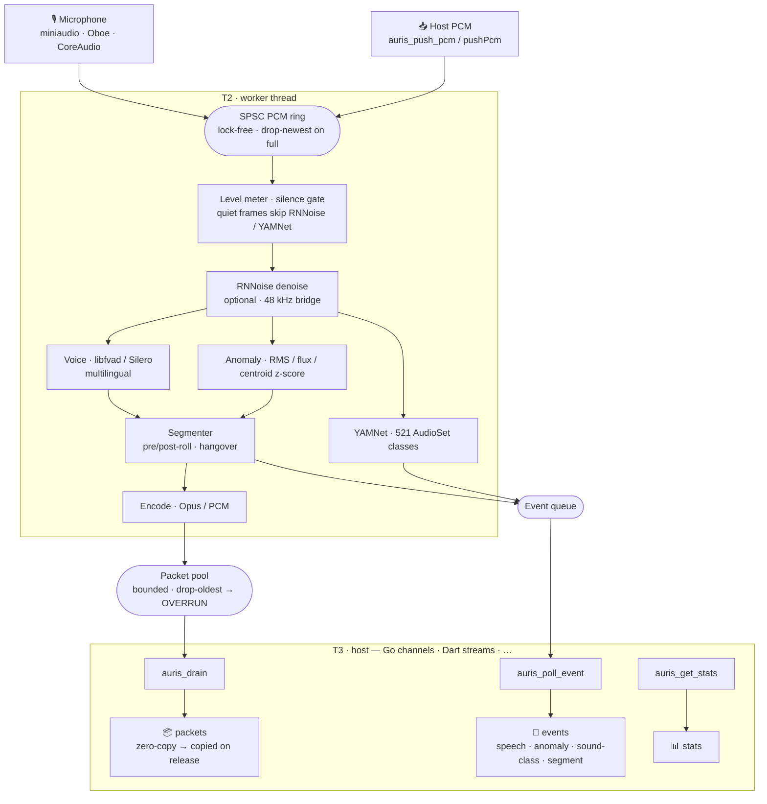

# Auris

A native C++ audio capture + detection engine with a pure **C ABI**, designed to be
embedded from many languages (Dart/Flutter, Kotlin, Swift, Go, .NET, Python, Rust,
Node, WASM). Auris captures microphone audio, optionally denoises it, detects
**human voice** (multilingual) and **non-speech acoustic events**, classifies what it
hears, and streams only the relevant audio out as encoded packets.

> Status: capture → preprocess → detect → encode runs **live and verified on
> Android, iOS, and macOS**. Core is fuzzed, stress-tested, fault-injected, and
> clean under AddressSanitizer / UndefinedBehaviorSanitizer / ThreadSanitizer.

---

## What it does

| Stage | Component | Notes |
|---|---|---|
| Capture | miniaudio / Oboe (Android) / CoreAudio (Apple) | int16 mono, 8/16/32/48 kHz |
| Preprocess *(optional)* | **RNNoise** | recurrent noise suppression; bridged to its native 48 kHz |
| Voice detection | **libfvad** (fast) or **Silero v5** via ONNX Runtime (neural) | language-agnostic |
| Anomaly gate | RMS + spectral-flux + centroid z-scores (PFFFT) | adaptive rolling background |
| Sound classification | **YAMNet** via ONNX Runtime | all 521 AudioSet classes |
| Encode | **libopus** / PCM (FLAC planned) | per-segment |

Detection is one OR'd trigger: VAD or anomaly opens a *segment*; packets flow only
while a segment is open, so the host receives speech/events, not the silence between.

## Highlights

- **Multilingual voice** — two VAD tiers: `libfvad` (fast, zero-dependency) and Silero v5
  (neural). Both are language-agnostic; the neural tier catches faint/borderline speech.
- **One dial tunes everything** — `Sensitive(0..1)` maps a single value onto every
  detector's thresholds, or set each knob individually.
- **Knows what it hears** — YAMNet's 521 AudioSet classes, plus helpers that fold them into
  broad categories (speech / human / animal / music / nature) and a language-agnostic
  "is this a human voice?" check.
- **Mix and match** — enable any combination of RNNoise denoise, fast/neural VAD, anomaly
  gate, and sound classification, at any of 8/16/32/48 kHz, encoding to Opus or PCM.
- **Retune live** — `auris_update_config` changes detector thresholds on a running engine
  with no teardown, no model reload, and no loss of detector state.
- **Meter and tap** — per-frame input level (`input_rms_dbfs` / `input_peak_dbfs`) plus an
  optional *ungated* PCM tap, so a host can draw a waveform or archive the whole stream
  while still receiving segment-gated packets.
- **Cheap when nothing is happening** — a silence gate skips RNNoise and YAMNet on quiet
  input (VAD/anomaly stay live; audio always flows), so a quiet room costs ~0.4% of a core
  with *every* feature on. Per-window worker health (`worker_busy_ppm`, wakeups, max
  frame) is in the stats, and opt-in **adaptive degradation** sheds YAMNet work under
  load and restores it when calm — emitting `AURIS_EVT_DEGRADATION` so the host knows.
- **Deterministic** — packet/event timestamps depend only on frame position, not timing;
  a cross-binding conformance harness proves the Go and Flutter surfaces produce
  **byte-identical** output over the shared engine.
- **Hardened** — bounded lock-free queues, generation-guarded zero-copy packets, no
  exception crosses the ABI, and the worker can't crash the host; fuzzed, stress- and
  fault-injection-tested, clean under ASan / UBSan / TSan.
- **Live or offline** — capture from the mic (Android / iOS / macOS) or push your own PCM
  (`HOST_PCM`) to run files, network audio, or test vectors through the same pipeline.

## How it works

Three threads, two lock-free queues. Audio flows one way; the two queues are the
**only** coupling between real-time work and the host.



- **T1** (RT capture) is alloc-free and never blocks — it only pushes samples into the ring.
- **T2** (worker) preprocesses, runs all three detectors per frame, segments, and encodes.
  A segment opens on a VAD *or* anomaly trigger, so packets flow only while something is
  happening. Packet/event **timestamps are a deterministic function of frame position**,
  not wall-clock, so identical input yields identical output.
- **T3** (host) drains at any pace. A slow host just drains slower; T1/T2 never feel
  backpressure (the pool drops oldest and raises `AURIS_EVT_OVERRUN`).

The C ABI (`include/auris/auris.h`) is the contract: opaque handle, POD structs, status
codes, **no C++/exceptions/STL across the boundary**, zero-copy borrowed packets with an
explicit release (guarded by a generation cookie against stale double-release).

## Repo layout

```
include/auris/auris.h     the C ABI (the contract — bindings generate from this)
src/                      engine, detectors, encoders, capture backends, preprocess
third_party/              vendored, permissive-only deps (see Licensing)
tests/                    115 doctest cases incl. fuzz / stress / fault-injection
packages/                 Flutter federated plugin (auris + per-platform + example app)
bindings/go/              cgo binding (idiomatic Go API + example + tests)
bindings/python/          ctypes binding (no build step + example + tests)
examples/conformance/     Go ⇄ Dart byte-parity harness (run.sh)
```

---

## Building the core (CMake)

```bash
cmake -S . -B build -DAURIS_ENABLE_TESTS=ON \
      -DAURIS_ENABLE_NEURAL_VAD=ON          # Silero + YAMNet (needs ONNX Runtime)
cmake --build build -j
./build/test_auris                          # 115 cases
./build/bench_auris 20                      # CPU cost per feature, 20 s of audio
```

Useful options (all default to a sane value):

| Option | Default | Effect |
|---|---|---|
| `AURIS_ENABLE_TESTS` | OFF | build the doctest suite |
| `AURIS_ENABLE_NEURAL_VAD` | OFF | compile Silero VAD + YAMNet (ONNX Runtime) |
| `AURIS_ENABLE_RNNOISE` | OFF | compile RNNoise preprocessing |
| `AURIS_ENABLE_OPUS` | ON | compile the Opus encoder |
| **`AURIS_ENABLE_LOG`** | **OFF** | emit internal diagnostics to stderr/logcat. **Release builds are silent by default** — turn this on only to debug. |

### Performance

`bench/throughput.cpp` (built with the tests) pushes synthetic audio through `HOST_PCM`
faster than real time so the worker is the bottleneck, and reports the real-time factor
per feature. Release build, Apple M3 Max, one core:

| Configuration | Share of one core | Notes |
|---|---|---|
| passthrough · fast VAD · anomaly | 0.01% | the engine core is at the noise floor |
| Opus encode (complexity 5) | 0.32% | |
| neural VAD (Silero) | 0.43% | |
| RNNoise | 1.02% | includes the 16→48→16 kHz bridge |
| YAMNet, 1000 ms cadence (default) | 1.43% | 500 ms cadence: 2.84% |
| **everything + Opus** | **3.16%** | |
| everything + Opus, **quiet room** (−75 dBFS) | **0.40%** | silence gate sheds RNNoise + YAMNet |

Expect roughly 3× on a recent iPhone and 5–8× on mid-range Android. The two levers that
matter are both algorithmic: YAMNet's cadence (`sound_class_interval_ms`) and the silence
gate (`silence_gate_dbfs`, default −60; raise to about −50 to also shed quiet-room tone).
For constrained devices, `enable_adaptive_degradation` lets the engine step YAMNet's
cadence down (×2, ×4, then suspend) whenever the worker's busy share exceeds
`degrade_busy_ppm` or the capture ring drops frames, and step it back after ~3 calm
seconds. It is **off by default** because it reacts to wall-clock timing, which would make
faster-than-real-time offline runs (and the conformance harness) non-deterministic.

### Sanitizers

```bash
cmake -S . -B build-asan -DAURIS_ENABLE_TESTS=ON \
      -DCMAKE_CXX_FLAGS="-fsanitize=address,undefined -fno-omit-frame-pointer -g" \
      -DCMAKE_C_FLAGS="-fsanitize=address,undefined -fno-omit-frame-pointer -g"
cmake --build build-asan -j && ./build-asan/test_auris

cmake -S . -B build-tsan -DAURIS_ENABLE_TESTS=ON \
      -DCMAKE_CXX_FLAGS="-fsanitize=thread -fno-omit-frame-pointer -g" \
      -DCMAKE_C_FLAGS="-fsanitize=thread -fno-omit-frame-pointer -g"
cmake --build build-tsan -j && ./build-tsan/test_auris
```

## Minimal C usage

```c
auris_config_t cfg;
auris_config_defaults(&cfg);
cfg.backend = AURIS_BACKEND_HOST_PCM;   // or AUTO to use the OS mic
cfg.enable_vad = 1;

auris_engine_t* e = NULL;
if (auris_create(&cfg, &e) != AURIS_OK) { /* handle */ }
auris_start(e);

/* drain loop (your thread) */
auris_packet_t pkt;
while (auris_drain(e, &pkt) == AURIS_OK) {
    /* forward pkt.data[0..pkt.size) ... then: */
    auris_release(e, &pkt);             // borrowed — release promptly
}
auris_event_t ev;
while (auris_poll_event(e, &ev) == AURIS_OK) { /* SPEECH_BEGIN, ANOMALY, ... */ }

auris_stop(e);
auris_destroy(e);
```

Ownership rules are enforced and tested: every `auris_create` pairs with one
`auris_destroy`; packet `data` is borrowed until the matching `auris_release`; no C++
exception ever crosses the ABI; invalid input returns a status, never crashes.

## Flutter

The `packages/` directory is a federated plugin (flat VGV-style layout). The Dart side
reaches the C ABI directly via `dart:ffi`; there are no platform channels on the hot
path. Detections, encoded **packets**, and stats arrive as Dart streams; `pushPcm` feeds
a `HOST_PCM` engine. See [`packages/auris/README.md`](packages/auris/README.md) and the
[example app](packages/auris/example) — a live demo with **feature presets** (voice-only,
everything, anomaly-watch, denoised-voice…), a sensitivity dial, and encoded-bytes meter.

```dart
final engine = AurisEngine.create(AurisConfig.sensitive(
  0.6,                                          // one 0..1 dial drives every detector
  vadTier: auris_vad_tier.AURIS_VAD_NEURAL,     // multilingual
  neuralVadModelPath: sileroPath,
  soundClassModelPath: yamnetPath,
  enableRnnoise: true,
));
```

## Go

`bindings/go` is a cgo binding over the same C ABI, with an idiomatic API:
detections and packets arrive on Go channels. Build `libauris` (CMake) once, then
`go test`. See [`bindings/go/README.md`](bindings/go/README.md).

```go
e, _ := auris.New(auris.Sensitive(0.6,
    auris.WithNeuralVADModel("silero_vad.onnx"),
    auris.WithSoundClassModel("yamnet_3s.onnx")))
e.Start()
for ev := range e.Events() {
    if ev.Type == auris.EventSpeechBegin { /* voice, any language */ }
}
```

The [example](bindings/go/example) is a flag-driven CLI that runs any combination of
backend (mic / file via `HOST_PCM`), VAD tier, detectors, RNNoise, and codec — plus
named `-preset`s (`voice`, `everything`, `anomaly`, `denoised-voice`, `music`) that show
common recipes.

## Python

`bindings/python` is a pure-**ctypes** binding — no compiler, no build step, no
third-party runtime dependency. See [`bindings/python/README.md`](bindings/python/README.md).

```python
import auris

with auris.Engine(auris.sensitive(0.6)) as engine:
    engine.start()
    for event in engine.events(timeout=10):
        if event.type is auris.EventType.SPEECH_BEGIN:
            print("voice, any language")
```

`push_pcm` takes anything buffer-like (`bytes`, `array('h')`, numpy `int16`), so
running files or datasets through the same pipeline is a few lines.

## Cross-binding conformance

[`examples/conformance`](examples/conformance) is a bidirectional differential
test across **every pair** of bindings (Go ⇄ Dart ⇄ Python): each peer feeds
deterministic audio to the other, processes it through its own binding over the
shared engine, and verifies the two produce **byte-identical** encoded packets,
events, and timestamps — proving all three language surfaces stay in sync.

```bash
cd examples/conformance && ./run.sh
# → ✅ conformance passed — every binding pair is byte-identical
```

---

## Platform integration notes

These are the non-obvious requirements that make the native library link and capture
correctly on each platform. They are encoded in the build files under `packages/` —
this section explains *why*, so they don't get accidentally removed.

### Android (`packages/auris_android`)
- **NDK r28+** and `-Wl,-z,max-page-size=16384 -Wl,-z,common-page-size=16384` — 16 KB
  page alignment required by Android 15+. Oboe ≥ 1.10 and ONNX Runtime ≥ 1.26 ship
  16 KB-aligned `.so`s.
- **Oboe** via Prefab (`find_package(oboe CONFIG)`); **ONNX Runtime** via a glob of the
  Gradle transform cache + `SHARED IMPORTED` (the AAR has no Prefab metadata).
- `abiFilters arm64-v8a, x86_64`.
- The shared C/C++ lives at the repo root and is reached via `AURIS_ROOT`. AGP marks the
  native build `upToDateWhen=false`, so out-of-tree edits *are* picked up by a plain
  `flutter build` (no cache clear needed) — see the note in `android/build.gradle`.

### iOS & macOS (`packages/auris_ios`, `packages/auris_macos`)
- A podspec `prepare_command` rsyncs the repo's C/C++ tree into the pod, and
  `source_files` globs compile it inline so symbols land in the host app.
- **Static linkage**: `use_frameworks! :linkage => :static` (ONNX ships a static
  xcframework that CocoaPods otherwise rejects).
- **FFI symbol export (critical).** `DynamicLibrary.process()` searches the executable's
  *dynamic symbol table*. With static linkage the linker keeps only link-time-referenced
  objects, and the C ABI is only referenced at runtime from Dart — so without help the
  symbols are dropped and lookups fail with *"symbol not found"*. Two pieces fix it:
  1. `AurisPlugin.register()` (always called by Flutter) references the ABI under a
     never-true guard, anchoring its transitive closure into the binary.
  2. The podspec adds `-Wl,-export_dynamic` to the **consumer** target, publishing those
     default-visibility symbols into the dynamic table.
- **Swift Package Manager.** `auris_ios` and `auris_macos` each ship a `Package.swift`
  alongside their podspec and build under either integration (Flutter supports both).
  SwiftPM requires a target's sources to live inside the package, so
  `<plugin>/Sources/auris_native/` holds **symlinks** to the shared tree rather than
  copies — the package cannot drift from the source of truth, and git stores ~10 links
  instead of 10 MB each. Three things are load-bearing:
  - `rnnoise/src` must **not** be on the header search path. RNNoise vendors a fork of
    celt (`arch.h`, `pitch.h`, `kiss_fft.h`, `celt_lpc.h`) that *shadows* opus' headers
    of the same name and silently miscompiles opus (mismatched `celt_inner_prod`
    signatures, missing `celt_sig_assert`/`opus_fft`). Both podspecs carried the same
    latent hazard; it is now gone from all four build files.
  - Under SwiftPM the C engine is a separate module, so `AurisPlugin.swift` does
    `#if canImport(auris_native) import auris_native` — the CocoaPods build puts
    everything in one target and needs no import.
  - **Full feature parity**, including Silero neural VAD and YAMNet: the packages depend
    on Microsoft's
    [onnxruntime-swift-package-manager](https://github.com/microsoft/onnxruntime-swift-package-manager)
    (pinned to 1.24.2), whose `onnxruntime` binary target wraps
    `pod-archive-onnxruntime-c` — the *same* artifact the `onnxruntime-c` pod uses. Its
    headers arrive framework-style, hence the extra
    `__has_include(<onnxruntime/onnxruntime_cxx_api.h>)` arm in the detectors.
    That dependency sets the SPM floor at **iOS 15 / macOS 14**; the podspecs keep their
    lower minimums (iOS 14 / macOS 11), so CocoaPods users are not forced up.
- **Microphone permission & capture:**
  - **iOS** RemoteIO can't capture until an `AVAudioSession` (record category) is
    configured and activated — done in the capture backend. `permission_handler` needs
    `PERMISSION_MICROPHONE=1` in the app Podfile, or it reports `denied` unconditionally.
  - **macOS** a `HALOutput` unit must be bound to the default *input* device
    (`kAudioOutputUnitProperty_CurrentDevice`), or it captures silence. miniaudio's path
    doesn't request authorization, so the demo calls `AVCaptureDevice.requestAccess`
    up front (the app carries the audio-input entitlement + usage string).

### Bundled models
`silero_vad.onnx` (v5.1.2, ~2 MB), `yamnet_3s.onnx` (~15 MB), and RNNoise's model
(baked into `rnn_data.c`). The Silero/YAMNet models ship as Flutter assets and are
extracted to an app-writable path at runtime.

---

## Licensing

Auris is permissive-only — **no GPL/LGPL**. Vendored dependencies:

| Dep | License |
|---|---|
| miniaudio | public domain / MIT-0 |
| libfvad | BSD-3-Clause (WebRTC) + MIT |
| PFFFT | BSD-like (FFTPACK-derived) |
| libopus | BSD-3-Clause |
| RNNoise | BSD-3-Clause (Xiph) |
| ONNX Runtime | MIT (linked, not vendored) |
| doctest | MIT (test only) |
